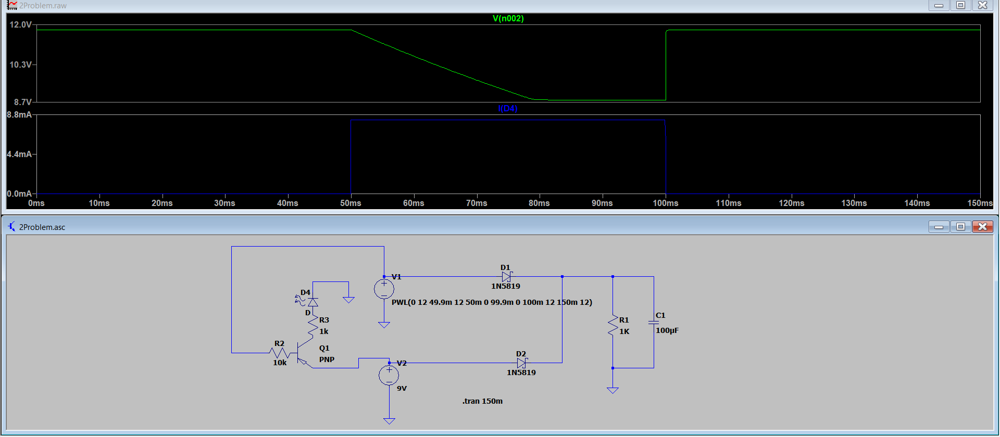

# Automatic 12V-to-9V Diode-ORing UPS Switchover Circuit

🏆 **1st Place — Concept to Circuit** | TechnoVIT'26 (Annual Technical Festival, VIT Chennai, Sept 2026)

A discrete analog power-path switchover circuit that automatically switches a load from a 12V primary supply to a 9V backup battery during a power outage, upgraded with Schottky diodes, brownout protection, and a PNP-based outage alarm.

---

## Circuit Schematic & Simulation

---

## Baseline vs. Upgraded Design

| Feature | Baseline (Silicon ORing) | Upgraded Circuit | Benefit |
| :--- | :--- | :--- | :--- |
| **ORing Diodes** | Standard Silicon (~0.7V drop) | 2× Schottky Diodes (~0.2V drop) | Raises load voltage from 11.3V / 8.3V to ~11.8V / 8.8V; lowers heat loss |
| **Blackout Transition** | Sharp vertical drop at 50ms | 100µF capacitor in parallel with load | Smooths voltage decay (brownout protection) so sensitive loads don't reset |
| **Outage Indication** | None | PNP Transistor + LED stage | Automatically lights alert LED (~8 mA from 9V backup) during main failure |

---

## How It Works (PWL Transient Test: 0ms – 100ms)

### 1. Normal Power (0ms – 50ms)
* The 12V main supply powers the load through the primary Schottky diode, delivering **~11.8V** (vs. 11.3V with a silicon diode).
* Because 11.8V > 9V, the backup Schottky diode stays reverse-biased and the 9V battery remains idle.
* The 12V rail keeps the PNP transistor **OFF**, so the outage LED stays dark.

### 2. Primary Failure / Blackout (50ms – 100ms)
* At **50ms**, the 12V PWL source drops to 0V.
* The **100µF capacitor** discharges into the load, preventing a sharp vertical voltage drop and giving a smooth ramp down to **~8.8V** as the 9V backup battery takes over.
* With the 12V rail gone, the **PNP transistor turns ON**, routing **~8 mA** from the 9V backup rail through the LED to signal a power outage.

### 3. Power Restoration (100ms+)
* At **100ms**, the 12V main supply returns, immediately reverse-biasing the backup diode.
* Load voltage returns to **~11.8V**, the 9V battery goes idle again, and the PNP transistor switches **OFF**, turning off the alert LED.

---

## Bill of Materials (BOM)
* 2× Schottky Diodes
* 1× PNP Transistor
* 1× 100µF Electrolytic Capacitor
* 2× 1kΩ Resistors
* 1× 10kΩ Resistor
* 1× LED (Outage Indicator)
* 12V Main Source (PWL for transient testing) & 9V Backup Battery
* Breadboard & Connecting Wires

---

## Recognition
Secured **1st Place** in *Concept to Circuit* at TechnoVIT'26, VIT Chennai (3rd–4th September 2026).

